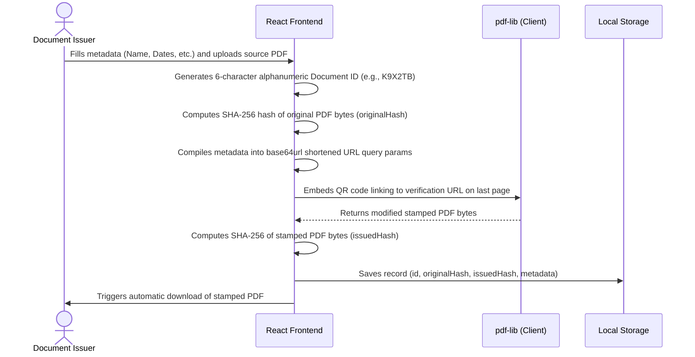
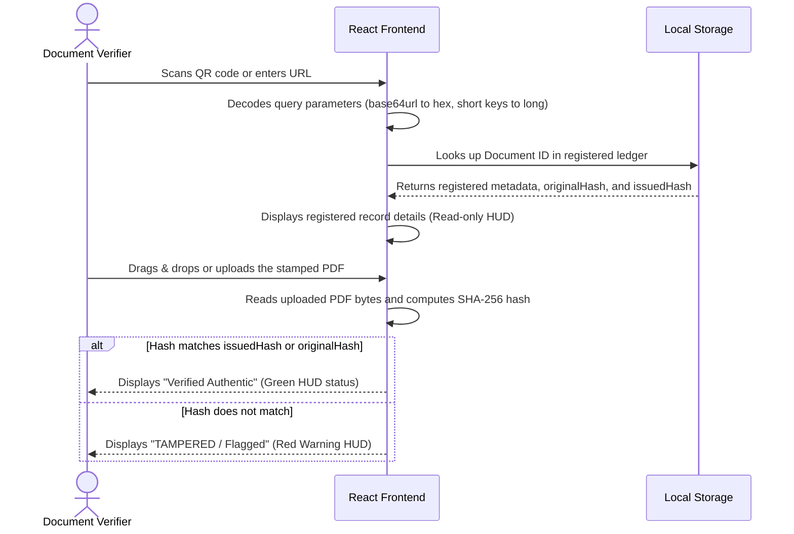

# Secure QR Verification System Workflow & Architecture

This document describes how the QR-Verification system secures, registers, stamps, and cryptographically verifies documents.

---

## 1. System Overview

The system consists of two primary parts:
1. **Frontend App (Vite + React)**: A standalone, premium single-page application that performs client-side PDF stamping (using `pdf-lib`), QR code generation, cryptographic hashing, and visual verification. It simulates a database using `localStorage` for quick, serverless execution.
2. **Backend API (Node.js + Express + MongoDB)**: A production-ready REST API that handles secure authentication (JWT), document registration, server-side PDF stamping, database storage, audit logging, and cryptographic verification checks.

---

## 2. Core Cryptographic Concepts

To guarantee document integrity and prevent forgery, the system relies on standard cryptographic primitives:

- **SHA-256 Hashing**: Generates a unique 256-bit (32-byte) binary signature of any input (metadata text or binary PDF file). Even a single-bit change in the document will result in a completely different hash (the avalanche effect).
- **QR Code Verification URL**: Contains compressed metadata representing the document. To keep the QR code simple, clean, and fast to scan, hashes are encoded in **base64url** format (reducing 64 hex characters to 43 characters), and keys are shortened (e.g. `documentId` becomes `id`).

---

## 3. Workflow Diagrams

### A. Document Issuance & Stamping

### B. Document Verification

---

## 4. Component-by-Component Walkthrough

### A. Frontend React Application (`/frontend`)

#### 1. Registration (`UploadPage`)
- **Metadata Form**: Allows selection of document category (e.g., Academic, Employment, Medical, Invoice, Legal, Government ID) and dynamic rendering of input fields based on the selected schema. All dates use native calendar pickers.
- **Unique ID Generation**: Generates a 6-character random alphanumeric string (e.g. `X9K2PJ`). The generator checks against `localStorage` to ensure absolute uniqueness before assignment.
- **Client-Side PDF Stamping**:
  - If a PDF is uploaded, `pdf-lib` embeds a high-quality QR code + verification text in the bottom-right corner of the final page.
  - If no PDF is uploaded, `pdf-lib` creates a premium certificate layout from scratch.
  - The QR code is overlayed with a clickable hyperlink annotation so digital viewers can click directly on the QR code to navigate to the verification page.

#### 2. Verification (`VerifyPage` & `CustomDropzone`)
- **Interactive Dropzone**: Allows dragging and dropping a PDF file or clicking to select. It computes the SHA-256 hash of the file bytes.
- **Auto-matching**: If the uploaded file's hash matches any registered document, the app automatically transitions to the verification screen for that document ID, triggering a high-tech scanning loader for 1.2 seconds before displaying details.
- **Visual HUD**: Displays the status (Active, Revoked, Expired), recipient details, issuer details, issue date, upload date, and a side-by-side comparison of the uploaded file's hash against the registered hash.

---

### B. Backend REST API (`/server`)

The backend mirrors the client-side logic but persists data securely to MongoDB:

1. **Database Models (`/models`)**:
   - `User`: Handles issuer accounts with passwords hashed via `bcryptjs`.
   - `Document`: Holds document metadata, `originalHash`, `issuedHash`, QR URL, and a `typeSpecificData` mixed object.
   - `VerificationRecord`: Logs every public verification request (IP address, user agent, timestamp) for audit trail tracking.

2. **Routes & Middleware (`/routes`, `/middleware`)**:
   - `uploadMiddleware`: Restricts file uploads to PDFs under 10MB using `multer`.
   - `authMiddleware`: Secures issuance endpoints with JWT verification.
   - `rateLimiter`: Limits verify requests to prevent DDoS/bruteforce attacks.

3. **Stamping & Storage (`/utils`)**:
   - Uses `pdf-lib` to load, stamp, and save PDF files on the server.
   - Files are stored in the `/uploads` folder and served statically over HTTP.