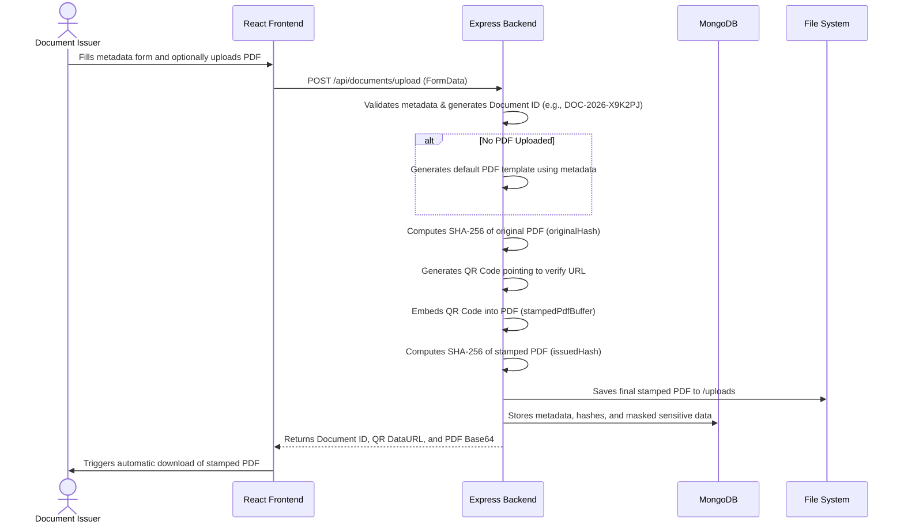
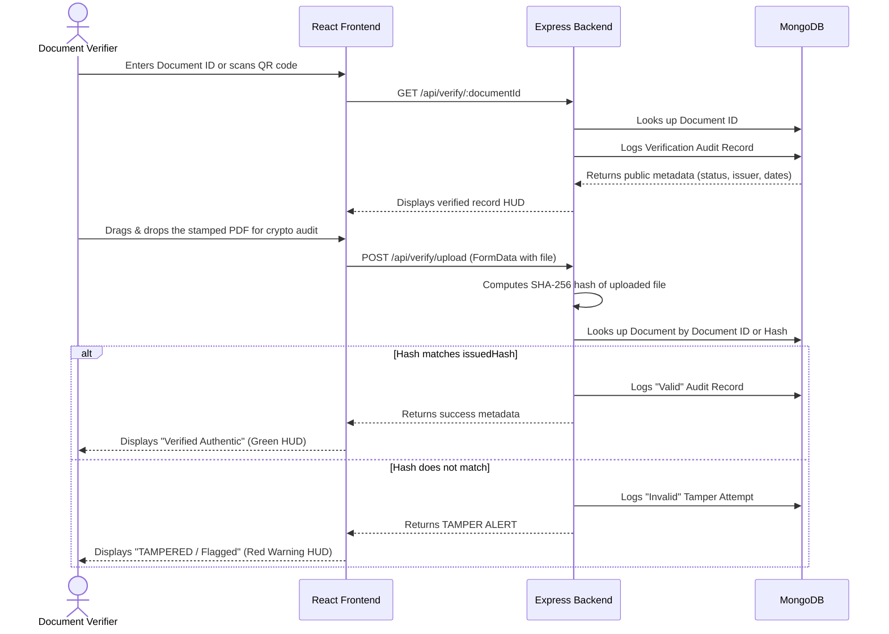

# Secure QR Verification System Workflow & Architecture

This document describes how the QR-Verification system secures, registers, stamps, and cryptographically verifies documents.

---

## 1. System Overview

The system consists of a robust full-stack architecture:
1. **Frontend App (Vite + React)**: A premium single-page application that provides the user interface for document issuance and verification. It securely transmits data to the backend and performs client-side hashing for visual verification feedback.
2. **Backend API (Node.js + Express + MongoDB)**: A production-ready REST API that handles secure document registration, server-side PDF generation/stamping (using `pdf-lib`), cryptographic hashing, database storage, and audit logging.

---

## 2. Core Cryptographic Concepts

To guarantee document integrity and prevent forgery, the system relies on standard cryptographic primitives:

- **SHA-256 Hashing**: Generates a unique 256-bit (32-byte) binary signature of any input (metadata text or binary PDF file). Even a single-bit change in the document will result in a completely different hash.
- **Dual-Hash System**:
  - `originalHash`: The hash of the un-stamped, source PDF (or the auto-generated blank template).
  - `issuedHash`: The hash of the final PDF *after* the QR code has been embedded.
- **QR Code Verification URL**: Contains a direct link to the system's `/verify/:documentId` route.

---

## 3. Workflow Diagrams

### A. Document Issuance & Stamping

### B. Document Verification

---

## 4. Component-by-Component Walkthrough

### A. Frontend React Application (`/frontend`)

#### 1. Registration (`UploadPage`)
- **Metadata Form**: Allows selection of document category (e.g., Certificate, Marksheet, Medical Report) and dynamic rendering of input fields based on the selected schema.
- **API Integration**: Collects form data and files into a `FormData` object and POSTs to `/api/documents/upload`.

#### 2. Verification (`VerifyPage` & `CustomDropzone`)
- **Interactive Dropzone**: Allows dragging and dropping a PDF file for verification.
- **Backend Audit**: Forwards the file to `/api/verify/upload` where the complete cryptographic audit occurs.
- **Visual HUD**: Displays the status (Active, Revoked), document metadata, and clearly flags if a tamper attempt (Hash Mismatch) is detected.

---

### B. Backend REST API (`/server`)

1. **Database Models (`/models`)**:
   - `Document`: Holds document metadata, `originalHash`, `issuedHash`, QR URL, verification count, and dynamically masked `typeSpecificData`.
   - `VerificationRecord`: Logs every public verification request (IP address, user agent, timestamp, result) for audit trail tracking.
   - `User`: Handles issuer accounts.

2. **Routes & Controllers (`/routes`, `/controllers`)**:
   - `documentController`: Handles issuance. It isolates common fields from type-specific fields, delegates PDF generation if no file is uploaded, computes both `originalHash` and `issuedHash`, and saves to MongoDB.
   - `verifyController`: Handles public verification checks. Returns only safe, public metadata, preventing exposure of internal hashes or sensitive user details unless successfully matched.

3. **Stamping & Storage (`/utils`)**:
   - `generateDefaultPdf.js`: Creates a premium PDF template if the user didn't upload one.
   - `embedQR.js`: Uses `pdf-lib` to overlay the QR code onto the final page of the PDF.
   - `hashFile.js`: Performs the crucial SHA-256 binary fingerprinting.
   - Files are stored in the `/uploads` folder.